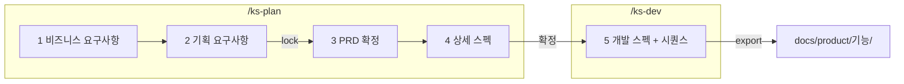

# spec-planning

> 새 기능을 만들기 전에 **기획서 → 상세 스펙 → 개발 스펙**을 Claude와 인터뷰하듯 채워 가는 Claude Code 플러그인

📖 **문서 바로가기** ·
[설계](docs/design.md) ·
[비즈니스 요구사항](docs/brief-guide.md) ·
[기획](docs/planning-guide.md) ·
[상세 스펙](docs/spec-guide.md) ·
[개발 스펙](docs/dev-guide.md) ·
[다이어그램](docs/diagram-guide.md) ·
[검사 CLI](docs/harness.md)

---

## 목차

1. [빠른 시작](#1-빠른-시작)
2. [이 도구가 하는 일](#2-이-도구가-하는-일)
3. [진행 순서](#3-진행-순서)
4. [한 번의 답이 처리되는 과정](#4-한-번의-답이-처리되는-과정)
5. [안전장치: 잠금과 대조](#5-안전장치-잠금과-대조)
6. [번호 체계](#6-번호-체계)
7. [결과물과 다시 고치기](#7-결과물과-다시-고치기)
8. [검사 CLI](#8-검사-cli)
9. [폴더 구조](#9-폴더-구조)
10. [고쳐 쓰기 (개발)](#10-고쳐-쓰기-개발)

---

## 1. 빠른 시작

**준비물**: Claude Code, Node 20 이상. 설치할 npm 패키지는 없다.

**① 설치** (Claude Code 입력창에서)

```text
/plugin marketplace add zpla15/spec-planning
/plugin install spec-planning@spec-planning
```

이 PC에서는 로컬 경로로 추가해도 된다.

```text
/plugin marketplace add <clone한 폴더 경로>
```

**② 기획 시작** (기획을 남길 프로젝트 폴더에서 Claude Code 실행)

```text
/ks-plan 게시글을 지우지 않고 고칠 수 있게 하고 싶다
```

**③ 개발 스펙** (기획이 확정되면 Claude가 먼저 물어본다. 따로 시작해도 된다)

```text
/ks-dev post-edit
```

**④ 결과 확인**: 프로젝트의 `docs/product/post-edit/`에 `prd.md`, `spec.md`, `dev.md`, `diagram.md`가 생긴다.

| 명령 | 언제 쓰나 |
|---|---|
| `/ks-plan <만들고 싶은 것 한 줄>` | 새 기능 기획을 시작하거나, 하다 만 기획을 이어 갈 때 |
| `/ks-plan <기능 영어 이름>` | 이미 내보낸 기획을 고칠 때 (결과물을 다시 불러온다) |
| `/ks-dev <기능 영어 이름>` | 기획 확정 뒤 개발 스펙을 쓸 때. 기획이 덜 됐으면 기획부터 이어 간다 |

---

## 2. 이 도구가 하는 일

AI에게 "기획서 써 줘"라고 하면 그럴듯하지만 **내가 정하지 않은 내용**이 섞여 나온다.
이 플러그인은 그걸 막기 위해 역할을 셋으로 나눈다.

| 누가 | 하는 일 | 하지 않는 일 |
|---|---|---|
| **나** | 내용을 정하고, 확정하고, 잠근다 | |
| **Claude** (`/ks-plan`, `/ks-dev`) | 앞 문서 문장을 인용해 질문하고, 내 답을 출처와 함께 옮긴다 | 빈칸을 추측으로 채우기, 요청에 없는 기능 제안 |
| **검사 CLI** (`scripts/pp.mjs`) | 형식, 빠진 분기, 근거, 링크, 잠금을 기계적으로 검사한다 | 문서 내용 쓰기 |

지키는 원칙

- **모르면 비워 두고 묻는다.** 정하지 못한 건 `## 정할 것`에 남고, 남아 있으면 확정이 안 된다.
- **단계를 건너뛰지 않는다.** 검사에 걸린 게 0건이어야 다음 단계로 간다.
- **모든 항목은 근거가 있다.** BR → 요구사항 → 트리 → 계약 → 작업 → 검증으로 이어지고, 끊긴 곳은 CLI가 찾는다.
- **기획과 개발을 섞지 않는다.** 기획 문서는 비개발자 말로, 개발 문서는 코드로 알 수 없는 것만 쓴다.
- **한 사실은 한 곳에만.** 다른 문서는 번호로 부르고, 내보낼 때 링크가 된다.

---

## 3. 진행 순서



| 단계 | 작업 파일 | 채우는 것 | 끝나는 조건 | 작성법 |
|---|---|---|---|---|
| 1 비즈니스 요구사항 | `brief.md` | 왜 지금, 목표(G)와 숫자 지표, 비즈니스 요구사항(BR)과 말한 사람 원문, 범위 밖, 제약 | 검사 0건 + 확정 | [brief-guide](docs/brief-guide.md) |
| 2 기획 요구사항 | `plan.md` | 페르소나(P), 요구사항(R), 완성 기준(R1-1…), 우선순위 | 검사 0건 + 잠금 | [planning-guide](docs/planning-guide.md) |
| 3 PRD 확정 | (1+2 합본) | 합친 모습을 한 번 읽고 확정 | 확정 | [planning-guide](docs/planning-guide.md) |
| 4 상세 스펙 | `spec.md`, `trace.json` | 상태표 → 조건표 → 단위(F, FN) → 분기 트리 → 요구사항 대조 | 모든 완성 기준이 트리 줄과 이어짐 | [spec-guide](docs/spec-guide.md) |
| 5 개발 스펙 | `dev.md`, `diagram.md` | 결정 → 아키텍처 → 데이터 → 계약 → 시퀀스 → 오류 → 제약 → 작업 → 검증 → 규칙 대조 | 검사 0건 + 확정 | [dev-guide](docs/dev-guide.md), [diagram-guide](docs/diagram-guide.md) |

상세 스펙의 분기 트리는 이렇게 생겼다. 줄 맨 앞 기호가 곧 문법이라 CLI가 읽고 검사할 수 있다.

```md
## F1 · 게시글 수정 · R1

- [게시글 상세] 진입
- ? 수정 권한이 있는가            ← ? 조건 분기 (조건표에 있어야 함)
  - **아니오**
    - → [수정] 단추가 보이지 않는다
  - **예**
    - ◆ 게시글 상태                ← ◆ 상태 분기 (상태표의 상태를 전부 갈래로)
      - **게시됨**
        - [수정] 누름 → 수정 모달이 열린다
        - ↪ FN1 수정 중 닫기        ← 함수 호출
      - **잠김**
        - → [수정] 단추가 비활성이다
```

| 기호 | 뜻 | | 기호 | 뜻 |
|---|---|---|---|---|
| `?` | 조건 분기 | | `[단추] 누름` | 사용자 행동 |
| `◆` | 상태 분기 | | `→` | 화면 결과 |
| `**갈래**` | 분기의 한 갈래 | | `⇒ A → B` | 데이터 상태 전이 |
| `↪ FN1` | 함수 트리 호출 | | | 분기 중첩은 3단계까지 |

---

## 4. 한 번의 답이 처리되는 과정

```text
내가 답함
  → Claude가 해당 파일 해당 칸에 옮김 (출처 줄 포함)
  → pp.mjs check 실행
  → 걸린 것 중 내 답이 필요한 것만 질문 1~3개로 바꿔 물음
     (번호 순서·표 모양 같은 형식 문제는 묻지 않고 Claude가 고침)
  → 걸린 게 없으면 다음 단계 첫 질문
```

질문에는 항상 **어느 문서 어느 줄**에서 나온 질문인지 원문이 붙는다.

```text
근거  기획 상세 스펙 › F1 › ? 수정 권한이 있는가 › **아니오**
원문  "→ [수정] 단추가 보이지 않는다"
질문  권한은 화면과 서버 중 어디서 확인하나요?
```

---

## 5. 안전장치: 잠금과 대조

프롬프트로 "바꾸지 마"라고 부탁하는 대신, **파일 지문을 비교해서** 막는다.

**요구사항 잠금 (`lock.json`)**

- 2단계가 끝나면 BR, 범위 밖, 페르소나, 요구사항, 완성 기준을 합친 지문을 저장한다.
- 이후 한 글자라도 바뀌면 `[잠근 뒤 바뀜]`으로 진행이 멈춘다.
- 내가 바꾼 게 맞으면 `unlock` → 확인 → 다시 `lock`.

**요구사항 대조 (`trace.json`)**

- 완성 기준마다 그걸 만족하는 트리 줄을 찾아 `met`(근거 줄) 또는 `missing`(무엇이 더 필요한지)을 적는다.
- CLI는 근거 줄이 **지금 트리에 실제로 있는지** 확인한다. 트리나 기준 문장이 바뀌면 `[대조 낡음]`.
- 이번에 안 할 기준은 `[제외: 사유]`를 붙여 대조에서 뺀다.

**출처 추적**

- 개발 스펙의 결정·계약마다 `출처:` 줄로 기획 원문을 인용한다.
- 기획 원문이 바뀌면 `[출처 낡음]`, 없는 번호를 부르면 `[깨진 링크]`, 아무도 안 부르면 `[외톨이]`.

---

## 6. 번호 체계

| 번호 | 뜻 | 문서 |
|---|---|---|
| `G1` `BR1` | 목표, 비즈니스 요구사항 | prd |
| `P1` `R1` `R1-1` | 페르소나, 요구사항, 완성 기준 | prd |
| `F1` `FN1` | 피쳐 트리, 함수 트리 | spec |
| `D1` `A1` `M1` `C1` `E1` `N1` `T1` `V1` | 결정, 구성 요소, 데이터, 계약, 오류, 제약, 작업, 검증 | dev |
| `S1` | 시퀀스 | diagram |

작업 파일에는 번호만 쓰고, 내보낼 때 `[R1](prd.md#r1)` 링크와 `쓰는 곳:` 역링크가 자동으로 붙는다.

---

## 7. 결과물과 다시 고치기

```text
<프로젝트>/
├─ .product-planning/{기능}/   ← 작업 중 임시 폴더 (자동 .gitignore, 끝나면 삭제)
│   brief.md  plan.md  lock.json  spec.md  trace.json  dev.md  diagram.md
└─ docs/product/{기능}/        ← 남는 결과물
    prd.md  spec.md  dev.md  diagram.md
```

| 결과물 | 읽는 사람 | 담는 것 |
|---|---|---|
| `prd.md` | 비개발자 | 왜 지금, 목표·지표, BR, 페르소나, 요구사항·완성 기준, 범위 밖 |
| `spec.md` | 기획자·개발자 | 상태표, 조건표, 피쳐·함수 분기 트리 |
| `dev.md` | 개발자 | 결정 기록, 아키텍처, 데이터, 계약, 오류, 제약, 작업, 검증, 프로젝트 규칙 대조 |
| `diagram.md` | 개발자 | 계약마다 Mermaid 시퀀스 |

- 기획만 끝난 상태로 내보내면 `prd.md`, `spec.md` 두 개만 나가고 작업 폴더는 개발용으로 남는다.
- 나중에 고칠 때는 `/ks-plan <기능>`이 `import`로 결과물을 작업 폴더로 되돌려 놓고 시작한다.
- 이미 있는 결과물은 `--force` 없이는 덮어쓰지 않는다.

---

## 8. 검사 CLI

평소에는 Claude가 알아서 부르지만, 직접 돌려 볼 수도 있다.

```bash
node scripts/pp.mjs check examples/post-edit
```

```text
단계  개발 › 5-4. 계약
완성도  R1 3/3 · 전체 100%
추가되어야 완성
1. [안 물어봄] "F1 › … › [수정] 누름 → 수정 모달이 열린다"를 인용한 계약이나 결정이 없다.
다음  트리의 사용자 행동을 원문을 인용해 무엇을 보내고 성공·실패 때 무엇을 받는지 묻는다.
```

| 명령 | 하는 일 |
|---|---|
| `init <폴더> [기능 이름]` | 지금 단계에 필요한 빈 틀만 만든다 |
| `check <폴더> [--json]` | 현재 단계, 완성도, 빠진 것, 다음 할 일 |
| `lock` / `unlock <폴더>` | 요구사항 잠금 / 해제 |
| `sheet <폴더>` | 요구사항 대조용 검토지(JSON) |
| `quotes <폴더>` | 개발 스펙이 인용할 수 있는 원문 목록(JSON) |
| `export <폴더> [프로젝트] [--force] [--keep]` | `docs/product/{기능}/`로 내보내기 |
| `import <프로젝트> <폴더>` | 결과물을 작업 폴더로 되돌리기 |
| `discard <폴더>` | 내보내지 않고 작업 폴더 삭제 |

종료 코드: `0` 완료 · `1` 아직 남음 · `2` 입력/경로 오류. 자세한 판정 순서는 [docs/harness.md](docs/harness.md).

---

## 9. 폴더 구조

```text
spec-planning/
├─ .claude-plugin/    plugin.json, marketplace.json (이 저장소가 곧 마켓플레이스)
├─ skills/
│  ├─ ks-plan/        기획 1~4단계를 이끄는 스킬
│  └─ ks-dev/         개발 스펙·시퀀스를 이끄는 스킬
├─ scripts/pp.mjs     검사 CLI 진입점
├─ src/               파서(brief, plan, spec, dev, diagram), 대조(trace), 링크, 보고, 내보내기
├─ docs/              설계서와 단계별 작성법 (각 200줄 이하)
├─ examples/post-edit 다섯 단계를 끝까지 통과한 예시 (게시글 수정)
└─ test/              node --test
```

---

## 10. 고쳐 쓰기 (개발)

```bash
npm test                                       # 23개 테스트
node scripts/pp.mjs check examples/post-edit   # 예시가 "단계 완료"인지
```

- 스킬 문구를 바꿨으면 Claude Code에서 `/plugin marketplace update spec-planning`으로 다시 읽힌다.
- 검사 규칙을 바꿨으면 `examples/post-edit`이 여전히 통과하는지 먼저 본다.
- 줄바꿈은 LF로 고정이다(`.gitattributes`). Windows에서 CRLF가 섞이면 테스트가 깨진다.
