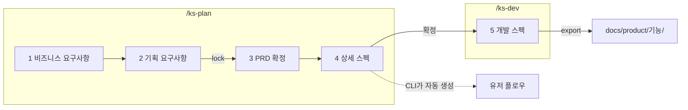

# harness-kit

> 기능 하나를 **셋업 → 기획 → 개발 스펙 → 코딩 → 검수 → 인계**까지 끊기지 않게 이어 주는 Claude Code 하네스 플러그인

📖 **문서 바로가기** ·
[작업 방식](docs/workflow.md) ·
[설계](docs/design.md) ·
[비즈니스 요구사항](docs/brief-guide.md) ·
[기획](docs/planning-guide.md) ·
[상세 스펙](docs/spec-guide.md) ·
[개발 스펙](docs/dev-guide.md) ·
[검사 CLI](docs/harness.md)

---

## 목차

1. [빠른 시작](#1-빠른-시작)
2. [이 도구가 하는 일](#2-이-도구가-하는-일)
3. [셋업: 프로젝트 유형별로](#3-셋업-프로젝트-유형별로)
4. [기획과 개발 스펙](#4-기획과-개발-스펙)
5. [한 번의 답이 처리되는 과정](#5-한-번의-답이-처리되는-과정)
6. [안전장치: 잠금과 대조](#6-안전장치-잠금과-대조)
7. [번호 체계](#7-번호-체계)
8. [결과물과 다시 고치기](#8-결과물과-다시-고치기)
9. [구현 검수](#9-구현-검수)
10. [인계와 훅](#10-인계와-훅)
11. [검사 CLI](#11-검사-cli)
12. [폴더 구조](#12-폴더-구조)
13. [고쳐 쓰기 (개발)](#13-고쳐-쓰기-개발)

---

## 1. 빠른 시작

**준비물**: Claude Code, Node 20 이상. 설치할 npm 패키지는 없다.

**① 설치** (Claude Code 입력창에서)

```text
/plugin marketplace add zpla15/harness-kit
/plugin install harness-kit@harness-kit
```

저장소를 clone 했다면 그 폴더 경로로 추가해도 된다.

```text
/plugin marketplace add <clone한 폴더 경로>
```

**② 셋업** (프로젝트마다 한 번)

```text
/ks-setup
```

새 프로젝트인지 진행된 프로젝트인지, 개인인지 팀인지 보고 확인받은 뒤, 커밋 방식과 검증 명령을 정하고 기준선 테스트를 돌린다.

**③ 기능 하나 만들기**

```text
/ks-plan 게시글을 지우지 않고 고칠 수 있게 하고 싶다     ← 기획 인터뷰
/ks-dev post-edit                                       ← 개발 스펙 인터뷰
"T1부터 만들어줘"                                        ← 코딩은 평소처럼
/ks-check post-edit                                     ← 스펙대로 됐는지 검수
/ks-handoff                                             ← 기록 정리, 커밋·PR
```

다음 세션을 열면 훅이 진행 기록을 불러와 "어디까지 했고 다음은 뭔지"부터 알려 준다.

| 명령 | 언제 쓰나 |
|---|---|
| `/ks-setup` | 프로젝트에서 처음 쓸 때. 다시 부르면 설정을 보여 주고 바꿀지 묻는다 |
| `/ks-lite <하고 싶은 것 대충>` | 기획 문서까지는 과한 보통 기능. 되묻고 문제를 짚으며 주고받은 뒤 한 장으로 정리한다 |
| `/ks-plan <만들고 싶은 것 한 줄>` | 새 기능 기획을 시작하거나, 하다 만 기획을 이어 갈 때 |
| `/ks-plan <기능 영어 이름>` | 이미 내보낸 기획을 고칠 때 (결과물을 다시 불러온다) |
| `/ks-dev <기능 영어 이름>` | 기획 확정 뒤 개발 스펙을 쓸 때. 기획이 덜 됐으면 기획부터 이어 간다 |
| `/ks-check [기능]` | 구현이 끝났다고 말하기 전, 커밋·PR 전에. 비우면 남은 작업에서 고른다 |
| `/ks-handoff [남길 말]` | 오늘 여기까지, 한 작업 단위가 끝났을 때 |

작은 수정이나 버그는 기획 없이 바로 코딩하고 `/ks-check`(가벼운 검수) → `/ks-handoff`로 끝낸다.

---

## 2. 이 도구가 하는 일

AI 코딩이 망가지는 이유는 보통 코딩 실력이 아니다. **무엇을 만들지가 흐리고**, **만든 게 맞는지 아무도 확인하지 않고**, **세션이 바뀌면 어디까지 했는지 잊기** 때문이다.
harness-kit은 이 셋을 막는다. 코딩 방식 자체는 묶지 않는다.

| 막는 것 | 어떻게 | 명령 |
|---|---|---|
| 뭘 만들지 흐림 | 인터뷰로 기획과 개발 스펙을 쓰고, 검사 CLI가 빠진 것을 찾는다. 가벼운 일은 되묻고 문제를 짚으며 정한다 | `/ks-plan` `/ks-dev` `/ks-lite` |
| 확인 없이 "다 됐어요" | 테스트를 돌려 기준선과 비교하고, 코드를 못 고치는 검수 에이전트가 작업마다 근거를 찾는다 | `/ks-check` |
| 세션마다 맥락 유실 | 진행 기록을 파일에 남기고, 훅이 세션 시작 때 불러오고 압축 직전에 저장한다 | `/ks-handoff` + 훅 |
| 프로젝트마다 다른 진행 | 유형을 판단해 커밋 방식과 검증 명령을 정해 둔다 | `/ks-setup` |

| 누가 | 하는 일 | 하지 않는 일 |
|---|---|---|
| **나** | 내용을 정하고, 확정하고, 잠그고, 커밋을 승인한다 | |
| **Claude** | 원문을 인용해 묻고, 답을 옮기고, 코드를 짜고, 부족한 것을 고친다 | 빈칸을 추측으로 채우기, 검수 없이 완료 선언 |
| **검수 에이전트** (`ks-checker`) | 작업·검증마다 코드와 테스트에서 근거를 찾아 판정한다 | 코드 고치기 |
| **검사 CLI·훅** | 형식, 근거, 링크, 잠금 검사. 작업 목록 추출, 체크, 진행 기록 저장 | 문서 내용 쓰기 |

지키는 원칙

- **모르면 비워 두고 묻는다.** 정하지 못한 건 `## 정할 것`에 남고, 남아 있으면 확정이 안 된다.
- **단계를 건너뛰지 않는다.** 검사에 걸린 게 0건이어야 다음 단계로 간다.
- **모든 항목은 근거가 있다.** BR → 요구사항 → 유스케이스 → 계약 → 작업 → 검증 → 코드로 이어지고, 끊긴 곳은 CLI와 검수가 찾는다.
- **기획과 개발을 섞지 않는다.** 기획 문서는 비개발자 말로, 개발 문서는 코드로 알 수 없는 것만 쓴다.
- **대화 말고 파일에 남긴다.** 진행은 `.harness/progress.md`에, 프로젝트 결정은 `.harness/decisions.md`에.

개인 공통 규칙(모든 프로젝트에 같이 쓰는 내 규칙)은 이 플러그인에 넣지 않는다. 사용자 전역 CLAUDE.md에 두면 플러그인이 읽고 지킨다.

---

## 3. 셋업: 프로젝트 유형별로

| | 개인 | 팀 |
|---|---|---|
| **새 프로젝트** | 바로 만들고 main에 커밋 | 규칙 파일은 팀과 정하게 두고, 첫 PR로 올림 |
| **진행된 프로젝트** | 점검 → 빠진 것만 추가 → 커밋 | 점검 → 제안 → 브랜치 + PR. 남의 문서는 고치지 않음 |

- 유형은 소스·커밋 수, 커밋 작성자 수, 원격 저장소 주인을 보고 **추측한 뒤 확인받는다.**
- 커밋 방식은 유형에 맞게 추천하고 내가 고른다. 개인은 main에 바로, 팀은 브랜치 + PR이 추천이다.
- 팀 프로젝트는 진행 기록을 `.git/info/exclude`로 빼서 내 PC에만 둔다. 프로젝트 `.gitignore`는 건드리지 않는다.
- 진행된 프로젝트는 지금 테스트를 한 번 돌려 **기준선**으로 남긴다. 원래 실패하던 테스트는 나중에 내 탓으로 치지 않는다.

```text
<프로젝트>/.harness/
├─ config.json   유형, 커밋 방식, 검증 명령, 기준선
├─ progress.md   지금 상태, 다음 할 일, 막힌 것, 기록
└─ decisions.md  프로젝트 전체 결정 (날짜, 결정, 이유, 버린 대안)
```

### 가볍게 정하기: `/ks-lite`

기획서까지 쓸 일은 아닌데, 대충 던진 요청을 그대로 만들면 빠뜨리는 게 생긴다. `/ks-lite`는 코드를 먼저 읽고 **되묻고, 생길 문제와 선택지를 먼저 짚으며** 계속 주고받는다.

```text
나:     /ks-lite 편지 예약 발송 넣고 싶어
Claude: 이렇게 이해했어요: 작성자가 시각을 정하면 그때 편지가 간다.
        정리  ❓ 취소 · ❓ 최대 기간 · ❓ 발송 실패
        지금 발송은 요청 즉시 한 번만 보내요 (src/letters/send.ts:22).
        예약이면 정해진 시각에 돌 작업이 필요해요. ① 1분마다 확인 (추천) ② 예약마다 타이머
나:     1
Claude: 정리  ✅ 1분마다 확인 · ❓ 취소 · ❓ 발송 실패
        서버가 그 시각에 꺼져 있으면 편지가 밀려요. 켜지면 바로 보낼까요, 버릴까요?
  … (답마다 새로 생긴 문제를 다시 짚음)
Claude: 더 정할 건 없어 보여요. 정리할까요?
```

- 범위, 권한, 경계·실패, 기존 기능과 부딪힘, 데이터, 보안, 성능, 사용자 경험, 확인 방법을 렌즈로 질문거리를 찾는다.
- 코드로 알 수 있는 것과 사소한 것은 묻지 않는다. "알아서 해"면 추천안으로 정한다.
- 끝나면 `.harness/lite/{기능}.md` 한 장(목표, 정한 것, 남은 문제, 요구사항, 작업 T, 검증 V)을 남기고, 바로 코딩 → `/ks-check`로 이어진다.
- 정할 것이 10개를 넘거나 여러 사람이 볼 기능이면 `/ks-plan`으로 올리자고 한다.

---

## 4. 기획과 개발 스펙



| 단계 | 작업 파일 | 채우는 것 | 끝나는 조건 | 작성법 |
|---|---|---|---|---|
| 1 비즈니스 요구사항 | `brief.md` | 왜 지금, 목표(G)와 숫자 지표, 비즈니스 요구사항(BR)과 말한 사람 원문, 범위 밖, 제약 | 검사 0건 + 확정 | [brief-guide](docs/brief-guide.md) |
| 2 기획 요구사항 | `plan.md` | 페르소나(P), 요구사항(R), 완성 기준(R1-1…), 우선순위 | 검사 0건 + 잠금 | [planning-guide](docs/planning-guide.md) |
| 3 PRD 확정 | (1+2 합본) | 합친 모습을 한 번 읽고 확정 | 확정 | [planning-guide](docs/planning-guide.md) |
| 4 상세 스펙 | `spec.md`, `trace.json` | 상태표 → 조건표 → 단위(F, FN) → 유스케이스 흐름 → 요구사항 대조 | 모든 완성 기준이 흐름 줄과 이어짐 | [spec-guide](docs/spec-guide.md) |
| 5 개발 스펙 | `dev.md` | 결정 → 아키텍처 → 데이터 → 계약 → 흐름 설계 → 오류 → 제약 → 작업 → 검증 → 규칙 대조 | 검사 0건 + 확정 | [dev-guide](docs/dev-guide.md) |

### 상세 스펙은 유스케이스 틀로 쓴다

기호나 그림 없이 **번호와 낱말만** 쓴다. 메모장이나 메신저로 봐도 흐름이 읽혀야 하기 때문이다.
유스케이스 하나는 항목 표 + 기본 흐름 + 대안 흐름 + 예외 흐름으로 이루어진다.

```md
## F1 · 게시글 수정 · R1

| 항목 | 내용 |
|---|---|
| 목적 | 작성자가 올린 글을 지우지 않고 바로 고친다 |
| 행위자 | P1 |
| 기본 흐름 조건 | 수정 권한이 있는가: 예, 게시글 상태: 게시됨 |
| 성공 결과 | 고친 글이 보이고 댓글은 그대로 남는다 |
| 실패 시 보장 | 저장하지 못하면 원래 글이 그대로 남는다 |

### 기본 흐름
- 1. 사용자가 수정을 누른다
- 2. 수정 모달이 열린다
- 3. 사용자가 글을 고치고 저장을 누른다
- 4. 고친 글이 보이고 댓글은 그대로 남는다

### 대안 흐름
- 1a. 수정 권한이 있는가: 아니오
  - 1a1. 수정 단추가 보이지 않는다
  - 1a2. 끝난다
- 3a. 사용자가 저장하지 않고 닫기를 누른다
  - 3a1. FN1 수정 중 닫기를 따른다

### 예외 흐름
- 3b. 저장이 실패한다
  - 3b1. 저장되지 않았다는 안내가 뜬다
  - 3b2. 2로 돌아간다
```

| 규칙 | 내용 |
|---|---|
| 갈림 번호 | 갈라진 단계 번호 뒤에 a, b (`3a`), 그 안의 처리는 `3a1`, `3a2` |
| 갈림의 끝 | "N으로 돌아간다", "끝난다", "FN번호 이름을 따른다" 셋 중 하나로 반드시 닫는다 |
| 대안 vs 예외 | 대안은 조건표·상태표의 갈래, 예외는 실패와 끊김 (개발 스펙의 오류 `E` 재료가 된다) |
| 재료 먼저 | 상태표·조건표에 없는 상태나 조건이 나오면 흐름보다 표를 먼저 고친다 |
| 깊이 | 갈림 안의 갈림은 3단계까지. 더 깊으면 함수(FN)로 뺀다 |

### 유저 플로우는 그리지 않는다

`flow.md`는 사람이 쓰지 않는다. CLI가 상세 스펙의 유스케이스를 읽어 Mermaid flowchart로 만든다.
기본 흐름은 차례로, 대안은 갈림 이름을 단 화살표로, 예외는 점선으로 이어진다. `pp.mjs flow <폴더>`로 언제든 미리 볼 수 있다.

---

## 5. 한 번의 답이 처리되는 과정

```text
내가 답함
  → Claude가 해당 파일 해당 칸에 옮김 (출처 줄 포함)
  → pp.mjs check 실행
  → 걸린 것 중 내 답이 필요한 것만 질문 1~3개로 바꿔 물음
     (번호 순서·표 모양 같은 형식 문제는 묻지 않고 Claude가 고침)
  → 걸린 게 없으면 다음 단계 첫 질문
```

질문에는 항상 **어느 문서 어느 줄**에서 나온 질문인지 원문이 붙는다. 코드를 읽었으면 코드 위치도 붙는다.

```text
근거  기획 상세 스펙 › F1 › 대안 흐름 › 1a. 수정 권한이 있는가: 아니오
원문  "1a1. 수정 단추가 보이지 않는다"
근거 코드  src/posts/permission.ts:14
질문  권한은 화면과 서버 중 어디서 확인하나요? 서버에서도 막아야 하나요?
```

---

## 6. 안전장치: 잠금과 대조

프롬프트로 "바꾸지 마"라고 부탁하는 대신, **파일 지문을 비교해서** 막는다.

**요구사항 잠금 (`lock.json`)**

- 2단계가 끝나면 BR, 범위 밖, 페르소나, 요구사항, 완성 기준을 합친 지문을 저장한다.
- 이후 한 글자라도 바뀌면 `[잠근 뒤 바뀜]`으로 진행이 멈춘다.
- 내가 바꾼 게 맞으면 `unlock` → 확인 → 다시 `lock`.

**요구사항 대조 (`trace.json`)**

- 완성 기준마다 그걸 만족하는 흐름 줄을 찾아 `met`(근거 줄) 또는 `missing`(무엇이 더 필요한지)을 적는다.
- CLI는 근거 줄이 **지금 상세 스펙에 실제로 있는지** 확인한다. 흐름이나 기준 문장이 바뀌면 `[대조 낡음]`.
- 이번에 안 할 기준은 `[제외: 사유]`를 붙여 대조에서 뺀다.

**출처 추적**

- 개발 스펙의 결정·계약·흐름 설계마다 `출처:` 줄로 기획 원문을 인용한다.
- 유스케이스의 행동과 갈림마다 흐름 설계 표에 한 줄이 있어야 한다. 없으면 `[안 물어봄]`.
- 기획 원문이 바뀌면 `[출처 낡음]`, 없는 번호를 부르면 `[깨진 링크]`, 아무도 안 부르면 `[외톨이]`.

---

## 7. 번호 체계

| 번호 | 뜻 | 문서 |
|---|---|---|
| `G1` `BR1` | 목표, 비즈니스 요구사항 | prd |
| `P1` `R1` `R1-1` | 페르소나, 요구사항, 완성 기준 | prd |
| `F1` `FN1` | 유스케이스, 함수 흐름 | spec |
| `D1` `A1` `M1` `C1` `E1` `N1` `T1` `V1` | 결정, 구성 요소, 데이터, 계약, 오류, 제약, 작업, 검증 | dev |

작업 파일에는 번호만 쓰고, 내보낼 때 `[R1](prd.md#r1)` 링크와 `쓰는 곳:` 역링크가 자동으로 붙는다.

---

## 8. 결과물과 다시 고치기

```text
<프로젝트>/
├─ .product-planning/{기능}/   ← 작업 중 임시 폴더 (자동 .gitignore, 끝나면 삭제)
│   brief.md  plan.md  lock.json  spec.md  trace.json  dev.md
└─ docs/product/{기능}/        ← 남는 결과물
    prd.md  spec.md  flow.md  dev.md
```

| 결과물 | 읽는 사람 | 담는 것 |
|---|---|---|
| `prd.md` | 비개발자 | 왜 지금, 목표·지표, BR, 페르소나, 요구사항·완성 기준, 범위 밖 |
| `spec.md` | 기획자·개발자 | 상태표, 조건표, 유스케이스·함수의 기본·대안·예외 흐름 |
| `flow.md` | 기획자·개발자 | 기능 전체 유저 플로우 (Mermaid, CLI가 생성) |
| `dev.md` | 개발자 | 결정 기록, 아키텍처, 데이터, 계약, 흐름 설계, 오류, 제약, 작업, 검증, 프로젝트 규칙 대조 |

- 기획만 끝난 상태로 내보내면 `prd.md`, `spec.md`, `flow.md` 세 개만 나가고 작업 폴더는 개발용으로 남는다.
- 나중에 고칠 때는 `/ks-plan <기능>`이 `import`로 결과물을 작업 폴더로 되돌려 놓고 시작한다. 유저 플로우는 상세 스펙에서 다시 만든다.
- 이미 있는 결과물은 `--force` 없이는 덮어쓰지 않는다.

---

## 9. 구현 검수

`/ks-check`는 **개발 스펙을 채점표로** 코드를 검수한다. 부족하면 고치고 다시 검수해, 모두 충족할 때까지 돈다.

```text
pp.mjs tasks dev.md          작업(T)·검증(V) 목록 꺼내기
   → 검증 명령 실행          기준선과 비교: 기존 실패 / 새 실패
   → ks-checker 에이전트     T·V마다 근거(경로:줄, 테스트 이름)를 찾아 판정
   → 부족한 것 고치기 ──┐
   ↑────────────────────┘    같은 항목이 3번 연속 부족이면 멈추고 나에게 넘김
   → pp.mjs done dev.md T1   충족한 작업만 체크
```

```text
검수  post-edit · T2, T3 · 2번째
검증  npm test  42 통과 / 2 기존 실패 / 새 실패 0

| 번호 | 판정 | 근거 | 부족한 점 |
|---|---|---|---|
| T2 | 충족 | posts.service.ts:41 | |
| V2 | 부족 | posts.service.ts:55 | 댓글 유지 테스트 없음 |
| 기타 | 부족 | posts.controller.ts:12 | 스펙에 없는 삭제 API가 추가됨 |
```

| 판정 | 뜻 |
|---|---|
| 충족 | 구현이 있고, 그 동작을 확인하는 테스트가 통과한다 |
| 부족 | 구현이 없거나 다르다. 또는 테스트가 없거나 실패한다 |
| 확인 불가 | 화면처럼 자동으로 볼 수 없다. 확인 방법을 받아 내가 확인한다 |

- 검수자는 코드를 짠 대화와 따로 둔다. 자기 코드를 자기가 채점하지 않게 하려는 것이다.
- 스펙이 틀렸다고 보이면 코드를 스펙에서 벗어나게 고치지 않고 `/ks-dev`로 돌아간다.
- 개발 스펙이 없는 작은 일은 **가벼운 검수**다. 시킨 일 한 줄, diff, 테스트 결과만 본다.

---

## 10. 인계와 훅

**`/ks-handoff`** 는 일을 멈출 때 `.harness/progress.md`를 정리하고 커밋 방식대로 커밋·PR을 준비한다.

| 칸 | 내용 |
|---|---|
| 지금 상태 | 하고 있는 일, 브랜치, 마지막 검수 |
| 다음 할 일 | 1~3개. 첫 줄은 바로 칠 수 있는 명령 (`/ks-check post-edit`) |
| 막힌 것·정할 것 | 내가 답해야 하는 것 |
| 기록 | 날짜, 한 일, 커밋·PR (30줄이 넘으면 `history.md`로) |

세션에서 프로젝트 전체에 걸친 결정(스택, 구조, 배포, 규칙)을 했으면 `.harness/decisions.md` 맨 위에 날짜, 이유, 버린 대안과 함께 더한다. 기능 하나의 결정은 개발 스펙의 결정 기록(D)에 남는다.

커밋, push, PR은 각각 묻고 한다. 팀 프로젝트에서는 main에 바로 커밋하지 않는다.

**훅** 은 플러그인을 설치하면 자동으로 돈다.

| 훅 | 언제 | 하는 일 |
|---|---|---|
| SessionStart | 새 세션, 이어하기, `/clear`, 압축 뒤 | 설정 요약, 진행 기록, 최근 결정, 남은 작업(T), 진행 중인 기획을 대화에 넣는다 |
| PreCompact | 대화가 압축되기 직전 | progress.md 맨 아래 `## 자동 저장`에 브랜치, 최근 커밋, 바뀐 파일, 남은 작업을 저장한다 |

- `.harness/`도 기획 폴더도 없는 프로젝트에서는 아무것도 하지 않는다.
- 훅이 실패해도 세션은 막히지 않는다.

---

## 11. 검사 CLI

평소에는 Claude가 알아서 부르지만, 직접 돌려 볼 수도 있다.

```bash
node scripts/pp.mjs check examples/post-edit
```

```text
단계  개발 › 5-4. 계약
완성도  R1 3/3 · 전체 100%
추가되어야 완성
1. [안 물어봄] "F1 › 기본 흐름 › 3. 사용자가 글을 고치고 저장을 누른다"를 인용한 계약이나 결정이 없다.
다음  흐름의 사용자 행동을 원문을 인용해 무엇을 보내고 성공·실패 때 무엇을 받는지 묻는다.
```

| 명령 | 하는 일 |
|---|---|
| `init <폴더> [기능 이름]` | 지금 단계에 필요한 빈 틀만 만든다 |
| `check <폴더> [--json]` | 현재 단계, 완성도, 빠진 것, 다음 할 일 |
| `flow <폴더>` | 상세 스펙으로 유저 플로우(Mermaid)를 만들어 보여 준다 |
| `lock` / `unlock <폴더>` | 요구사항 잠금 / 해제 |
| `sheet <폴더>` | 요구사항 대조용 검토지(JSON) |
| `quotes <폴더>` | 개발 스펙이 인용할 수 있는 원문 목록(JSON) |
| `export <폴더> [프로젝트] [--force] [--keep]` | `docs/product/{기능}/`로 내보내기 |
| `import <프로젝트> <폴더>` | 결과물을 작업 폴더로 되돌리기 |
| `discard <폴더>` | 내보내지 않고 작업 폴더 삭제 |
| `tasks <dev.md 또는 폴더>` | 작업(T)과 검증(V) 목록(JSON). 남은 작업이 있으면 종료 코드 1 |
| `done <dev.md 또는 폴더> <T번호...>` | 검수를 통과한 작업 줄에 `- [x]` 체크 |

종료 코드: `0` 완료 · `1` 아직 남음 · `2` 입력/경로 오류. 자세한 판정 순서는 [docs/harness.md](docs/harness.md).

---

## 12. 폴더 구조

```text
harness-kit/
├─ .claude-plugin/    plugin.json, marketplace.json (이 저장소가 곧 마켓플레이스)
├─ skills/
│  ├─ ks-setup/       프로젝트 셋업 (+ config, progress, decisions 템플릿)
│  ├─ ks-lite/        되묻고 짚으며 가볍게 정하기
│  ├─ ks-plan/        기획 1~4단계를 이끄는 스킬
│  ├─ ks-dev/         개발 스펙을 이끄는 스킬
│  ├─ ks-check/       구현 검수 루프
│  └─ ks-handoff/     진행 기록, 커밋·PR
├─ agents/ks-checker.md  읽기 전용 검수 에이전트
├─ hooks/hooks.json   SessionStart, PreCompact
├─ scripts/
│  ├─ pp.mjs          검사 CLI 진입점
│  └─ hook.mjs        훅 진입점
├─ src/               파서(brief, plan, spec, dev), 유저 플로우, 대조, 링크, 내보내기, 작업(work), 인계(handoff)
├─ docs/              작업 방식, 설계서, 단계별 작성법 (각 200줄 이하)
├─ examples/post-edit 기획·개발 스펙을 끝까지 통과한 예시 (게시글 수정)
└─ test/              node --test (검사 규칙, 작업·훅, 깨진 입력 fuzz)
```

---

## 13. 고쳐 쓰기 (개발)

```bash
npm test                                       # 전체 테스트
node scripts/pp.mjs check examples/post-edit   # 예시가 "단계 완료"인지
node scripts/pp.mjs tasks examples/post-edit   # 작업·검증 목록
```

- 스킬 문구를 바꿨으면 Claude Code에서 `/plugin marketplace update harness-kit`으로 다시 읽힌다.
- 검사 규칙을 바꿨으면 `examples/post-edit`이 여전히 통과하는지 먼저 본다.
- `docs/`, 스킬, 에이전트 파일은 200줄을 넘기면 테스트가 실패한다.
- 줄바꿈은 LF로 고정이다(`.gitattributes`). Windows에서 CRLF가 섞이면 테스트가 깨진다.

<br>

<sub>유스케이스 흐름, 요구사항 잠금, 검사 CLI 구조는 [YeongWon2/product-planning](https://github.com/YeongWon2/product-planning)을 참고했다.</sub>
